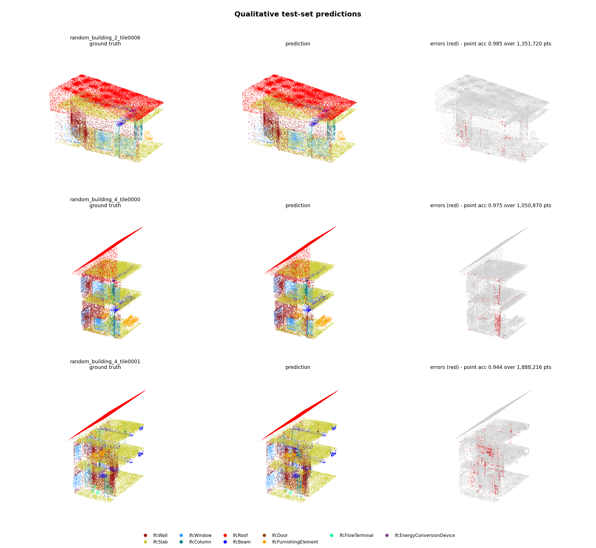
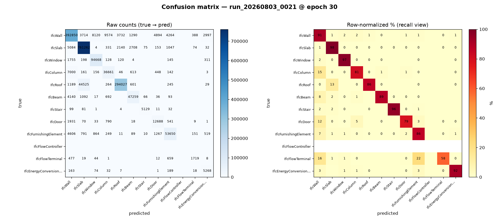
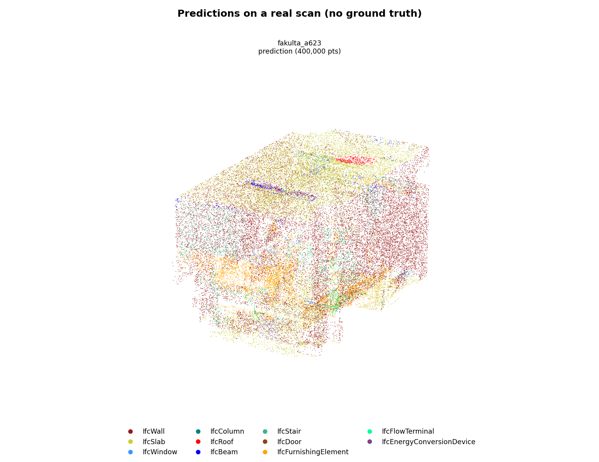
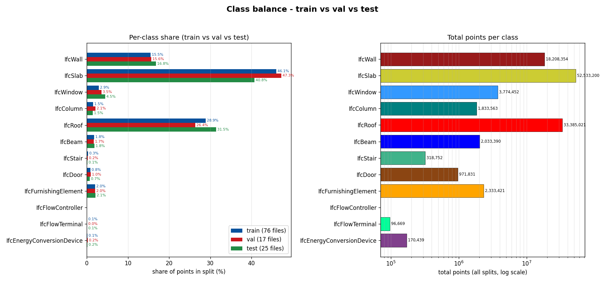
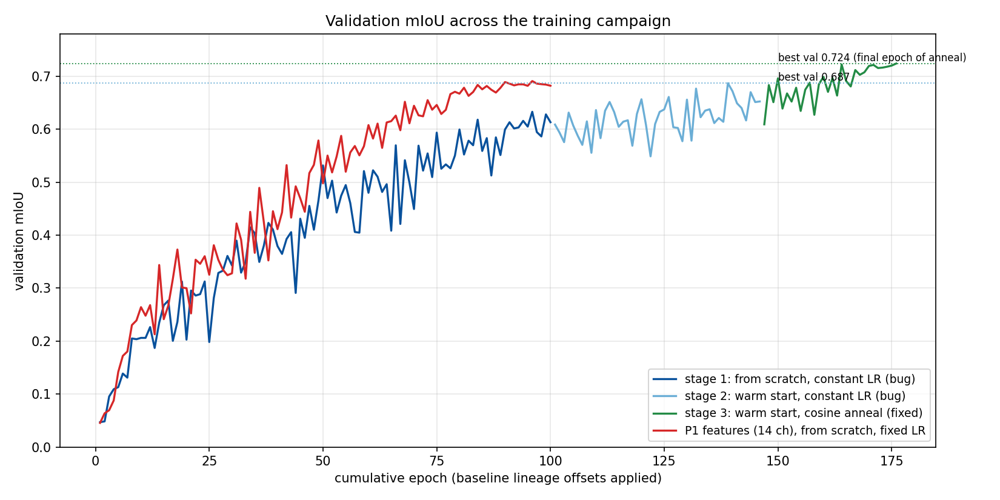
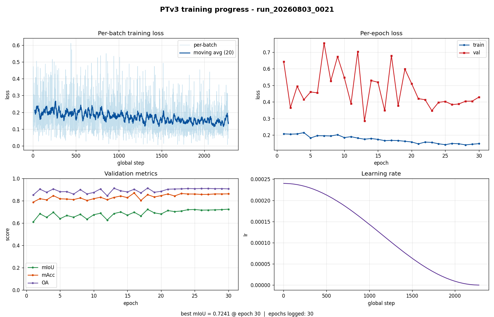
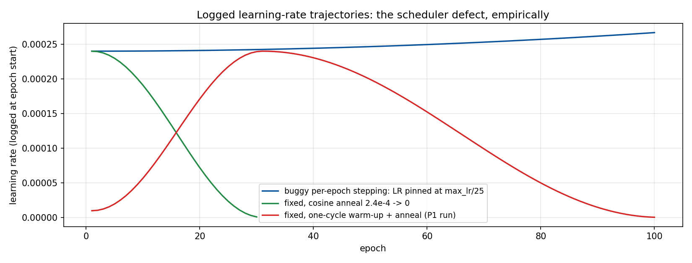

# Semantic Segmentation of Building Point Clouds into IFC Classes with Point Transformer V3

A Point Transformer V3 (PTv3) model that assigns every point of a building scan one of twelve
IFC component classes. Trained **from scratch** on twelve synthetic, procedurally generated
buildings, using **geometry-only features** — surface normals, no colour, no intensity, no
CAD prior.

**Input:** an unordered point cloud (`x, y, z`). **Output:** one IFC class label per point.

Held-out test split: **mIoU 0.749 / OA 0.930** at the voxel resolution the network consumes,
**mIoU 0.736 / OA 0.918** propagated back to all 18.6M original points.

Full technical report with the complete experimental record:
[`segmentation_report.pdf`](segmentation_report.pdf)
(source: [`segmentation_report.tex`](segmentation_report.tex)). This README is the condensed
version.

*Ground truth, prediction and error map on the three test tiles richest in doors, columns and
windows. Per-tile point accuracy 0.944–0.985. Errors (red) concentrate in thin lines along
class boundaries — wall–slab seams, window frames, column edges.*

### Classes

Twelve label indices (0–11): `IfcWall`, `IfcSlab`, `IfcWindow`, `IfcColumn`, `IfcRoof`,
`IfcBeam`, `IfcStair`, `IfcDoor`, `IfcFurnishingElement`, `IfcFlowController`,
`IfcFlowTerminal`, `IfcEnergyConversionDevice`.

`IfcFlowController` has **zero points in every split** of the current synthetic export, so
**every mIoU quoted here is an 11-class average**.

---

## Results

Final checkpoint `run_20260803_0021` (epoch 30, selected by validation mIoU), evaluated once
on the held-out 25-tile test split at grid size *g* = 0.06 m.

| Population | mIoU (11 classes) | OA | mAcc |
|---|---|---|---|
| voxel level (1.89M voxels) | **0.749** | **0.930** | **0.867** |
| full resolution (18.6M points) | **0.736** | **0.918** | **0.854** |

For scale: a majority-class predictor (always `IfcSlab`) reaches OA 0.408 / mIoU 0.037 on this
split, and the project's first fully-published model scored test mIoU 0.209.

### Per class

| Class | Support (voxels) | Recall | Precision | IoU (voxel) | IoU (full res) |
|---|---:|---:|---:|---:|---:|
| IfcStair | 5 357 | 0.957 | 0.971 | **0.931** | 0.923 |
| IfcSlab | 772 910 | 0.985 | 0.938 | **0.924** | 0.873 |
| IfcWindow | 97 329 | 0.973 | 0.910 | **0.888** | 0.902 |
| IfcWall | 431 823 | 0.910 | 0.937 | 0.857 | 0.871 |
| IfcRoof | 340 880 | 0.863 | 0.980 | 0.847 | 0.826 |
| IfcBeam | 53 395 | 0.885 | 0.899 | 0.805 | 0.809 |
| IfcFurnishingElement | 62 207 | 0.862 | 0.879 | 0.771 | 0.772 |
| IfcColumn | 45 230 | 0.811 | 0.752 | 0.640 | 0.585 |
| IfcDoor | 16 081 | 0.789 | 0.650 | 0.554 | 0.615 |
| IfcEnergyConversionDevice | 5 752 | 0.916 | 0.575 | 0.546 | 0.621 |
| IfcFlowTerminal | 2 939 | 0.585 | 0.729 | 0.480 | 0.297 |
| IfcFlowController | 0 | — | — | n/a | n/a |

Recall and precision are voxel-level; small-class IoU should be read from the full-resolution
column.

*Test confusion matrix, raw counts (left) and row-normalised recall (right).*

The weak classes are limited predominantly by **precision, not recall**. Doors are found
(recall 0.789) but wall voxels are over-predicted as door (precision 0.650); the same
asymmetry holds for `IfcEnergyConversionDevice` (0.916 / 0.575). `IfcColumn` is the one
genuine recall deficit — 15.5 % of column voxels are predicted wall — and `IfcRoof` →
`IfcSlab` is the largest error mass in absolute terms. Wall is no longer a sink class
(recall 0.910 / precision 0.937), and `IfcWindow` rose from IoU 0.190 in an early run to
0.888.

### On a real scan

*Geometry-only prediction on a real scanned room (16.4M points, tiled inference with overlap
voting). No ground truth exists, so no number is attached.*

The prediction is structurally plausible — walls, slab and furniture separate cleanly, and
classes that should not appear indoors essentially do not — but **the sim-to-real gap is
unquantified**.

One degenerate regime was identified: on scans decimated to 0.5 m point spacing, the 0.3 m
normal-estimation radius finds no neighbours, normals degenerate, and the model collapses to
predicting the dominant class.

---

## Data

Twelve synthetic buildings (footprints ≈17–31 m per side, 2–23M points each) exported as PLY
files whose per-point RGB encodes the IFC class. A preparation script nearest-matches colours
to class indices, tiles each building on an 8 × 8 m XY grid, and writes `[x, y, z, label]`
arrays. Unmatched colours become an ignore label (`-1`) excluded from loss and metrics —
2.1 % of training points.

Tiles are split at random with nominal ratios 70/15/15, yielding **76 / 17 / 25 tiles** and
**77.3M / 19.8M / 18.6M** labelled points. (The realised tile split is 64/14/21 % — random
assignment over 118 tiles, not a stratified draw.)

*Per-class share across the three splits (left) and absolute counts on a log scale (right).*

The corpus is imbalanced by **≈491×** between the most and least frequent non-empty classes —
`IfcSlab` dominates at 46.1 % of training points, `IfcFlowTerminal` sits below 0.1 %. Loss
uses inverse-square-root frequency class weights, *wc* ∝ 1/√*fc*,
normalised over non-empty classes.

---

## Method

### Features: geometry only, by design

In the synthetic corpus, **colour *is* the label**. Feeding RGB would let the network read the
answer off the input — perfect training metrics, zero transfer. The feature set is therefore
the estimated surface normal alone (3 channels).

This is deliberately impoverished. A normal encodes orientation but neither position nor local
shape, so classes sharing an orientation — a door leaf and its wall, a roof and a slab plane —
are locally indistinguishable and must be separated through spatial context alone. That
constraint explains where the remaining errors sit.

### Preprocessing

Identical at training and evaluation time:

1. **Per-tile centring** — *x*, *y* on the tile mean; *z* −= *z*min of the tile.
2. **Normal estimation** — Open3D hybrid KD-tree, radius 5*g*, max 30 neighbours
   (*g* = 0.06 ⇒ 0.30 m). No orientation step, so normal *signs* follow an arbitrary
   eigenvector convention — a reproducibility limitation.
3. **Grid sampling** — voxelisation at *g*, one representative point per occupied voxel, with
   the point-to-voxel map retained so predictions can be scored at full resolution.
4. **Augmentations** (train only) — random Z-rotation, isotropic scaling [0.9, 1.1], XY flips,
   coordinate jitter (σ = 5 mm, clipped at 2 cm).

### Configuration

PTv3 in its S3DIS configuration (five encoder stages, standard widths), `in_channels` = 3,
12-class linear head, *g* = 0.06 m, batch size 1, AdamW (weight decay 0.05), AMP, gradient
clipping at 1.0. MetaCentrum PBS, one NVIDIA A100 40GB / L40S 48GB per run; ≈200 s per epoch
over 76 tiles.

Batch size 1 is a memory constraint, not a tuning choice: in the non-flash RPE attention path
memory scales with points per forward, which bounds tile and batch size on 40–48 GB GPUs.

### Evaluation protocol

Checkpoints are selected on validation mIoU and the test split is evaluated **once** per
reported configuration — no maximisation over checkpoints or grids on test. Evaluation always
uses the training grid *g* = 0.06 (recovered from job logs, corroborated by the grid sweep).
Every reported number states its averaging population (11 classes) and its scoring level
(voxel or full resolution).

---

## Training

*Validation mIoU across the campaign. The baseline lineage (blues, green) accumulates 176
epochs over three warm-started stages; the cosine anneal (green) lifts the mean and collapses
the epoch-to-epoch variance. The P1 feature run (red) tracks above the equal-budget baseline
stage on validation yet scored worse on test.*

| Run | Init | LR schedule (effective) | Epochs | Best val | Test mIoU |
|---|---|---|---|---|---|
| `run_20260728_1204` | scratch | constant 2.4 × 10⁻⁴ (defect) | 100 | 0.633 | 0.654 |
| `run_20260729_1353` | warm start | constant 2.4 × 10⁻⁴ (defect) | 46 † | 0.687 | 0.713 |
| `run_20260802_2202` | warm start | one-cycle to 5 × 10⁻⁴ | 30 | — | *diverged* |
| `run_20260803_0021` | warm start | cosine 2.4 × 10⁻⁴ → 0 | 30 | 0.724 | **0.749** |
| `run_20260804_1517` | scratch | one-cycle to 2.4 × 10⁻⁴ | 100 | 0.691 | 0.655 (P1) |

† terminated externally at epoch 46 of 100 (SIGTERM; not a walltime limit; cause unrecorded).
Test numbers are voxel-level at *g* = 0.06.

*Final anneal run `run_20260803_0021`: per-batch and per-epoch loss, validation metrics, and
the executed cosine learning rate. Validation stabilises as the rate decays, and the best
epoch is the last — the schedule ended before improvement did.*

---

## Key findings

### 1. A silent learning-rate scheduler defect

*Logged learning rates. The defective run (blue) is pinned near 2.4 × 10⁻⁴; the repaired runs
execute a genuine cosine decay (green) and one-cycle (red).*

All runs before 2026-08-02 built a `OneCycleLR` scheduler with
`total_steps = epochs × batches = 7600` but stepped it **once per epoch** — advancing 100 of
7600 steps, 1.3 % of the schedule. The rate stayed within [2.40, 2.67] × 10⁻⁴, roughly
`max_lr/25`, and never approached the configured peak of 6 × 10⁻³; no warm-up and no anneal
were ever exercised. Confirmed numerically: rates predicted from per-epoch stepping match the
logged LR column to four significant figures at epochs 1, 46 and 100.

The defect was **invisible in standard logs** — training converged, loss fell, checkpoints
improved; only the LR column exposed it. Every pre-fix result is therefore effectively a
**constant-learning-rate** result, a lower bound rather than a tuned outcome.

### 2. Annealing was the single largest measured improvement

Repairing the scheduler and running 30 further epochs under cosine decay changed exactly one
variable relative to the constant-LR lineage. Seed and result were evaluated in the same job
on the same node, removing inter-node variance:

| Checkpoint | mIoU | OA | mAcc |
|---|---|---|---|
| constant-rate seed (`run_20260729_1353`) | 0.716 | 0.923 | 0.839 |
| + 30-epoch cosine anneal (`run_20260803_0021`) | **0.749** | **0.930** | **0.867** |
| Δ | **+0.033** | +0.007 | +0.028 |

The gain concentrated in the weak classes — Column +0.105, FlowTerminal +0.084, Door +0.060
IoU at voxel level — via improved precision at wall boundaries. Independently of the test set,
the anneal collapsed the last-10-epoch validation spread from 0.073 to **0.021** (3.5×) while
raising its mean from 0.647 to 0.716.

An earlier repaired run instead warm-started the best checkpoint with one-cycle at peak
5 × 10⁻⁴, on the reasoning that "only 2×" the rate the model had trained at must be safe. Loss
rose monotonically from epoch 5 and became non-finite at epoch 10, exactly at the schedule
peak: previous runs *sat* at 2.4 × 10⁻⁴ while still improving, whereas this one took an
already-converged model and ramped upward. Warm starts now use **monotonic decay only**, with
a divergence guard on non-finite loss.

### 3. Richer features made things worse — and we know why

A shallow probe (per-point random forest, no spatial context) indicated that height above
floor and multi-scale PCA shape descriptors carried real signal: on the voxelised cloud the
full feature set scored mIoU 0.460 against 0.229 for normals alone. The feature set was
extended to 14 channels and retrained from scratch.

Validation agreed — 0.691 mIoU, above the equal-budget baseline stage. Test did not:

| | mIoU (voxel) | mIoU (full res) | OA (full res) |
|---|---|---|---|
| baseline (176-epoch lineage) | **0.749** | **0.736** | **0.918** |
| P1, 14 channels (100 epochs) | 0.655 | 0.671 | 0.821 |

That is **−0.065 mIoU at full resolution** (−0.094 at voxel level). At equal budget the
comparison is starker: the 100-epoch normals-only run scored 0.654, so P1 — with more
information *and* a better schedule — merely matched it. One class improved dramatically
(`IfcFlowTerminal` +0.195 at full resolution) while everything structural degraded, worst of
all `IfcRoof` (−0.247) — the class height was supposed to help most.

**Diagnosis.** The height feature is *tile-relative*: *z* − *z*min(tile). Measured
across the corpus, tile *z*min varies by **1.10–1.54 m within a single building**
(tiles covering staircases, split levels, exterior grade), so a point at one real elevation
receives a height feature differing by up to half a storey depending on which tile it landed
in. The probe was blind to this: with no spatial context, a noisy "high ⇒ roof" rule still
helps a per-point classifier on average. But PTv3 already infers height-like information from
coordinates, so the explicit channel added mostly a *confidently inconsistent* signal — and
the class most dependent on absolute height collapsed.

The candidate fix (building-global *z*min) is implemented in the data path but
untrained. The transferable lesson: a validation probe must test not only whether a signal
**exists** but whether it is **consistent** across the sampling scheme.

---

Reference: Wu et al., *Point Transformer V3: Simpler, Faster, Stronger*, CVPR 2024.
